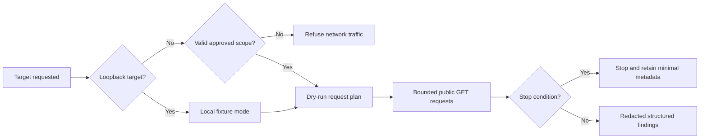

# Authorized Web Exposure Audit

A conservative, authorization-first skill for finding accidental exposure on a website’s public surface. It reviews a small set of public pages, API documentation paths, same-origin JavaScript bundles, document references, and response headers without attempting authentication bypasses or retrieving private records.

The project works as a reusable skill in both Codex and Claude Code and includes a deliberately vulnerable localhost fixture for safe demonstrations.

## Why this project exists

Modern web applications often expose more client-side information than teams intend: an OpenAPI document left public, an endpoint referenced in a bundle, a secret-like value embedded during a build, a document listed in a sitemap, or an unsafe header combination. This tool provides a repeatable way to review those signals while maintaining strict authorization and evidence-minimization boundaries.

It is not a vulnerability scanner, exploit framework, paywall bypass tool, or substitute for a professional penetration test.

## Highlights

- Requires a written scope file for every non-loopback target.
- Allows localhost demonstrations without external network traffic.
- Uses unauthenticated `GET` requests only.
- Stays on exact approved hosts, schemes, ports, and path prefixes.
- Never fetches discovered API endpoints, document links, source maps, or private-looking routes.
- Redacts suspected secrets and records only a short fingerprint.
- Enforces request, rate, timeout, body-size, and error ceilings.
- Stops on login forms, sensitive-data indicators, blocking, instability, or out-of-scope redirects.
- Produces machine-readable JSON and a concise Markdown report.
- Uses only the Python standard library.

## Safety model



Authorization is part of the design, not a disclaimer added afterward. Saying “I work there” or “this is only a test” is not sufficient authorization for a production system. Use the included localhost fixture, a system you control, or a target covered by explicit written permission or a published security-testing program.

## Checks performed

| Area | What the tool checks | What it does not do |
|---|---|---|
| API documentation | Fixed common public documentation paths and content indicators | Enumerate arbitrary paths or call documented endpoints |
| JavaScript | Same-origin scripts referenced by retrieved pages | Fetch source maps or third-party bundles |
| Secrets | High-confidence token and assignment patterns | Print, validate, or use suspected credentials |
| Documents | Links found in public pages, robots metadata, and sitemaps | Download or inspect linked documents |
| Headers | Selected security, caching, and CORS headers | Attempt browser-policy bypasses |
| Access control | Obvious unauthenticated availability on approved public paths | Guess identifiers, log in, bypass controls, or access records |

## Quick start: safe localhost demonstration

Requires Python 3.9 or newer. No third-party packages are needed.

Start the fake vulnerable site:

```bash
python3 scripts/demo_server.py --port 8765
```

In a second terminal, preview the request plan without sending traffic:

```bash
python3 scripts/audit_site.py http://127.0.0.1:8765/ --dry-run
```

Run the local audit:

```bash
python3 scripts/audit_site.py \
  http://127.0.0.1:8765/ \
  --output-dir demo-output
```

The fixture contains fake data only. Expected findings include public API documentation, endpoint references, a redacted fake secret, public-document references, and a deliberately risky CORS configuration.

## Installing as a skill

Keep the entire folder together.

For Codex, place it at:

```text
$CODEX_HOME/skills/authorized-web-exposure-audit
```

If `CODEX_HOME` is unset, use `~/.codex/skills/authorized-web-exposure-audit`.

For Claude Code, place it at either:

```text
.claude/skills/authorized-web-exposure-audit
~/.claude/skills/authorized-web-exposure-audit
```

Restart the relevant client if it does not detect the skill immediately.

## Authorized non-local use

Do not run the tool against a production or third-party system until the organization has approved the exact scope. The scope records:

- Organization and authorizer
- Exact scheme, hostname, and port
- Allowed and excluded path prefixes
- Validity window
- Request and rate ceilings
- Security contact

See [`references/scope-format.md`](references/scope-format.md) for the schema. Always run `--dry-run` first:

```bash
python3 scripts/audit_site.py \
  https://audit.example.com/ \
  --scope approved-scope.json \
  --dry-run \
  --output-dir audit-output
```

After a human confirms that the plan exactly matches the written approval, repeat without `--dry-run`.

## Output

- `findings.json` contains structured run metadata, observations, redacted findings, and the stop reason.
- `findings.md` is a concise review copy.

The scanner does not retain response bodies. URLs and response headers can still be sensitive in context, so review reports before sharing them.

See [`examples/sample-findings.md`](examples/sample-findings.md) for a stable, sanitized example and [`references/findings-template.md`](references/findings-template.md) for the full reporting structure.

## Project structure

```text
authorized-web-exposure-audit/
├── SKILL.md                         Agent workflow and safety boundaries
├── agents/openai.yaml               Codex interface metadata
├── scripts/audit_site.py            Scope-aware audit helper
├── scripts/demo_server.py           Local fake vulnerable site
├── references/scope-format.md       Approved-scope schema
├── references/findings-template.md  Reporting template
├── references/setup-and-examples.md Detailed operating instructions
├── examples/sample-findings.md      Sanitized example output
└── PORTFOLIO.md                     Concise project case study
```

## Limitations

- Pattern matching can produce false positives and false negatives.
- Public availability alone does not prove unintended exposure.
- The tool does not validate exploitability, credential validity, authorization boundaries, or business impact.
- It intentionally sacrifices coverage for predictable, low-impact behavior.
- It cannot determine whether a named authorizer has legal authority; the operator must verify that independently.

## Responsible use

If the tool identifies a suspected active secret or sensitive-data exposure, do not test it. Preserve minimal evidence, notify the approved security contact, recommend containment, and obtain separate permission before retesting. The complete workflow is in [`SKILL.md`](SKILL.md).

## Contributing and security

See [`CONTRIBUTING.md`](CONTRIBUTING.md) before proposing changes. Report vulnerabilities in this tool according to [`SECURITY.md`](SECURITY.md). Do not include live secrets, customer records, or unauthorized target data in issues or pull requests.

## License

Released under the [MIT License](LICENSE). The license covers this software, not permission to test systems you do not control.

